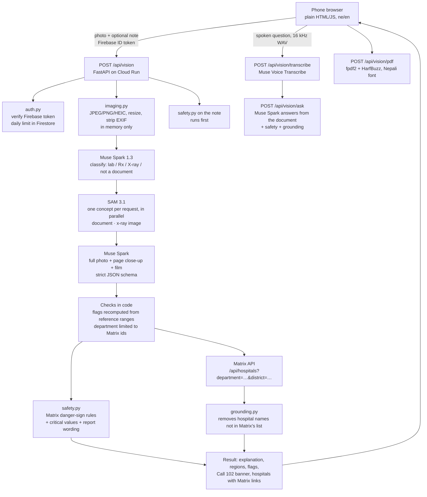

# Matrix Vision

Take a photo of a prescription, lab report or X-ray, and Matrix Vision explains it in simple Nepali, with English
alongside. You can listen to the explanation, see which results are out of range, ask follow-up questions by voice,
and get pointed to the right department and to hospitals in [Matrix](https://matrix.hospitalsofnepal.com).

It is a companion to Matrix and is planned to run at `matrixvision.hospitalsofnepal.com`. It uses Matrix's public
hospital API and the same Firebase sign-in, so people use the same Google account in both apps.

> Matrix Vision explains documents. It does not diagnose and never suggests changing a medicine or dose.
> Every page shows this disclaimer in Nepali and English.

## Architecture



Images are never written to disk or stored. Each request handles the photo in memory, and Meta calls are sent with
`store: false`. The only thing stored is a per-user daily counter, held in Firestore: user ID, date and counts.

## How the Meta tools are used

All endpoints, model IDs and request formats below were checked against [dev.meta.ai/docs](https://dev.meta.ai/docs)
before the code was written.

| Tool | Where | What it does here |
|---|---|---|
| **Muse Spark** (`muse-spark-1.3`, falls back to `1.2`, then `1.1`) | `app/understand.py` | Uses the Responses API through the official `openai` SDK (`base_url=https://api.meta.ai/v1`). Image input is sent as `input_image` data URLs. Structured output uses `text.format` = `json_schema` with `strict: true`. It makes three calls: **classify** (low reasoning effort, rejects photos that aren't medical documents), **extract** (the full photo plus SAM's close-ups; X-ray findings can point back to the film as `r0` for highlighting), and **answer** (follow-up questions, which also rewrite a spoken question into proper Nepali). |
| **SAM 3.1** (`sam-3.1`) | `app/segment.py` | Served on the Meta Model API itself (`/v1/responses`), so no self-hosting or GPU is needed. One concept per request, run in parallel: **"document"** finds the sheet of paper in the phone photo, and that close-up (full resolution, without the table or bed behind it) goes to Muse Spark; **"x-ray image"** finds the film, which is cropped for Muse Spark and highlighted on the photo when a finding refers to it. Its special-token output (`<\|box;x1=…;y1=…;x2=…;y2=…;w=…;h=…;c=…\|>`) is parsed into pixel boxes. Tested live: text-level concepts ("table", "printed text", "handwritten text") return no boxes on a printed page, so they are not used. |
| **Muse Voice Transcribe** (`muse-voice-transcribe-1.0`) | `app/voice.py`, `static/wav-recorder.js` | Spoken follow-up questions. The browser records 16 kHz mono 16-bit WAV, the only format the API accepts, and the server sends it as multipart (`request` JSON + `audio`) to `/v1/asr/transcribe`. |

**Known limits, stated plainly:**
- **Nepali speech:** Muse Voice doesn't list Nepali among its 25 languages. We set `languageBias` to Hindi and
  English (Hindi uses the same Devanagari script), then Muse Spark reads the transcript as Nepali and shows the user
  the question it understood. Voice is labelled beta, and a text box is always available.
- **Read-aloud:** Meta has no text-to-speech, so read-aloud uses the phone's own speech engine (Web Speech API). It
  picks a Nepali voice, then Hindi, and hides the button if neither is installed.

Retries follow Meta's error-handling guide (`app/meta_client.py`):
- 429, 500 and 503 get exponential back-off with jitter and respect `Retry-After`.
- 4xx errors are never retried.
- If one Muse Spark version stays unavailable, or returns JSON that doesn't validate, the next version is tried.

## Safety

`app/safety.py` is ported from Matrix. The 13 red-flag rules (English, Devanagari and romanised Nepali) are
unchanged and are tested to still fire. For documents, three things were added:
- **Critical lab values** compared in code: potassium, sodium, glucose, haemoglobin and platelets, with unit
  conversion for the units Nepali labs use (`gm%`, `/cumm`, `lakh/cumm`…).
- **Report wording** such as "critical value", "pneumothorax" and "midline shift".
- **Inputs:** the rules run on the patient's note, the document's own words and every question asked. They never run
  on the model's explanations, because "if you get chest pain, call 102" would trip them.

If any rule fires, the result shows **Call 102** (`tel:102`) and the 24-hour emergency hospitals from Matrix. Urgency
can only be raised by code, never lowered. The note is checked before any model call, so the banner appears even if
Muse Spark is down or not configured.

What this does not cover: if the model is down, numbers printed on the photo aren't checked, because there is no OCR
in code. Only the patient's note is. Thresholds and phrase lists need clinician review before launch.

## How it connects to Matrix

- `GET {MATRIX_API_BASE}/api/hospitals?department=<id>&district=<d>&lang=ne` returns the hospitals, cached for 10
  minutes. If none are in the district, it searches nationally, sorted by distance from that district.
- `GET {MATRIX_API_BASE}/api/config` provides the department list (the only departments Muse Spark may choose), the
  districts, and the public Firebase web config.
- Each hospital links to its Matrix page: `https://matrix.hospitalsofnepal.com/#/h/<id>`.
- **Grounding** (`app/grounding.py`): Muse Spark is told not to name hospitals, and the code enforces it. Every piece
  of model text goes through `strip_unlisted`, which keeps names from the Matrix list for this result and replaces
  everything else with "a hospital" or "अस्पताल":
  - other names from Matrix's directory;
  - English names ending in Hospital, Medical College, Centre or Institute;
  - Nepali names ending in अस्पताल, केन्द्र or प्रतिष्ठान.

  It has been checked against all 68 names currently in Matrix.
- Matrix currently marks all 68 hospitals `verified: false`, so the UI says "listed in Matrix" and shows Matrix's
  "not verified" badge rather than claiming they are verified.

## Setup

```bash
python3 -m venv .venv && .venv/bin/pip install -r requirements-dev.txt
cp .env.example .env            # AUTH_MODE=dev, STORE=memory for local work
set -a; . ./.env; set +a
.venv/bin/uvicorn app.main:app --reload --port 8080
.venv/bin/pytest -q             # Meta and Matrix are mocked; no keys needed
python scripts/make_samples.py  # regenerate samples/*.jpg
```

Without `META_API_KEY`, `/api/vision` returns `503 ai_not_configured`, but the safety check on the note still runs
and is returned.

### Environment variables

| Variable | Default | Notes |
|---|---|---|
| `META_API_KEY` | – | **Secret.** Meta Model API key. Set it in Secret Manager, never in the repo. |
| `META_API_BASE` | `https://api.meta.ai/v1` | |
| `MUSE_SPARK_MODELS` | `muse-spark-1.3,muse-spark-1.2,muse-spark-1.1` | Tried in order. |
| `SAM_MODEL` | `sam-3.1` | |
| `VOICE_MODEL` | `muse-voice-transcribe-1.0` | |
| `VOICE_LANGUAGE_BIAS` | `Hindi,English` | Nepali isn't supported by Muse Voice. |
| `MATRIX_API_BASE` | `https://matrix.hospitalsofnepal.com` | |
| `MATRIX_HOSPITAL_URL` | `{MATRIX_API_BASE}/#/h/{id}` | |
| `MATRIX_CACHE_SECONDS` | `600` | |
| `AUTH_MODE` | `firebase` | `dev` accepts `dev:<name>` tokens (local only). |
| `FIREBASE_PROJECT_ID` | `projects-4e426` | Same project as Matrix. |
| `FIREBASE_WEB_CONFIG` | read from Matrix | Optional JSON; public values. |
| `STORE` | `firestore` (if firebase) | `memory` for dev and tests. |
| `DAILY_VISION_LIMIT` / `DAILY_QUESTION_LIMIT` / `DAILY_PDF_LIMIT` | `10` / `30` / `30` | Per user per Nepal day. A use is given back when the failure is on our side. |
| `PUBLIC_ORIGIN` | `https://matrixvision.hospitalsofnepal.com` | Printed on the PDF. |

### Deploy (Cloud Run, same Firebase/GCP project as Matrix)

```bash
gcloud run deploy matrix-vision --source . --region asia-south1 \
  --set-env-vars AUTH_MODE=firebase,FIREBASE_PROJECT_ID=projects-4e426 \
  --set-secrets META_API_KEY=meta-api-key:latest \
  --memory 1Gi --timeout 180
```

Then:
1. Map the domain `matrixvision.hospitalsofnepal.com` to the service.
2. In Firebase Console → Authentication → Settings → Authorized domains, add `matrixvision.hospitalsofnepal.com`.
   Without it, Google sign-in fails with `auth/unauthorized-domain`.
3. Make sure the Cloud Run service account has the `Cloud Datastore User` role, for the Firestore counters.
4. Optional: add a Firestore TTL policy on `vision_usage.expires_at`, so old counters delete themselves.

## Project layout

```
app/
  main.py         routes: /api/config, /api/vision, /api/vision/{transcribe,ask,pdf}
  vision.py       the pipeline
  meta_client.py  Meta Model API client, retries, model fallback
  understand.py   Muse Spark prompts, parsing, checks done in code
  segment.py      SAM 3.1 calls and box-token parser
  voice.py        Muse Voice Transcribe
  safety.py       danger-sign rules (ported from Matrix) + document checks
  grounding.py    Matrix API client + hospital-name filter
  imaging.py      decode/resize/crop in memory
  pdf.py          summary PDF
  auth.py, store.py, schemas.py, config.py
static/           index.html, app.js, i18n.js, wav-recorder.js, styles.css, fonts/ (Mukta, OFL)
tests/            parsing, grounding, safety, SAM parser, routes (Meta/Matrix mocked)
samples/          synthetic documents: no real patients
scripts/          make_samples.py
```

## Status

- 139 tests pass with Meta and Matrix mocked.
- The UI was checked at 390 px wide in headless Edge, with the real Matrix API and Meta responses mocked.
- **Checked against the live Meta API (2026-10-27)** with the synthetic samples:
  - Muse Spark 1.3 accepts the strict `text.format` schema for classify, extract and answer; a scan takes about 18–28 s.
  - Values, ranges and medicines on all samples were read correctly; the critical sample raises Call 102 from code.
  - SAM 3.1 finds the paper in a photo and the X-ray film; text-level concepts find nothing (see above).
  - Muse Voice (Hindi bias) transcribed a spoken Nepali question almost word for word, and Muse Spark restated it
    in correct Nepali.
  - A question asking to double a dose was declined and sent back to the doctor.
- The Dockerfile has not been built here (no Docker on this machine).
